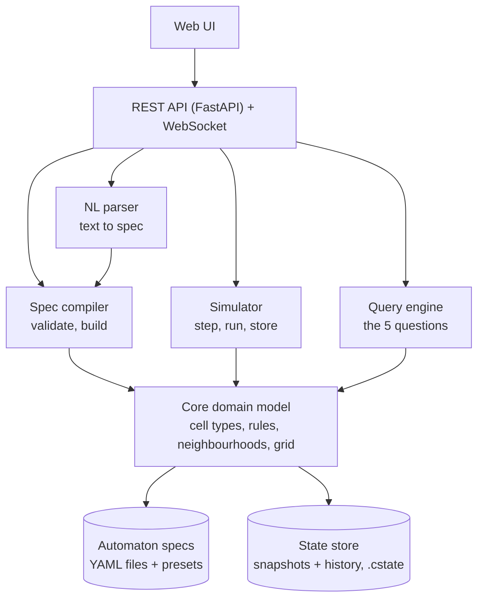
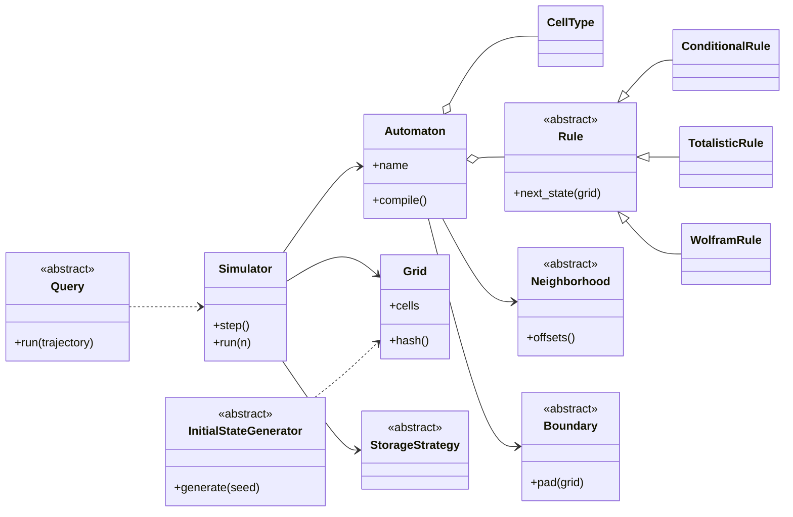
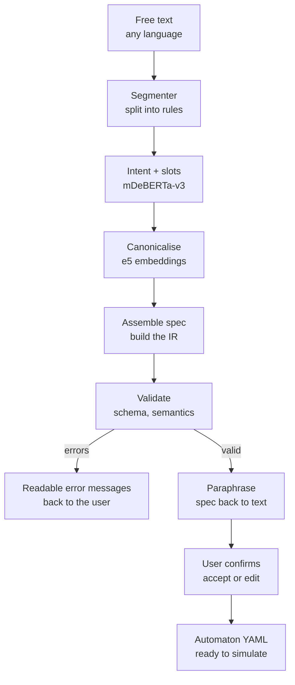

# CelLab

A cellular automata laboratory. The user describes an automaton in natural language, the system validates it, simulates future generations, stores them, and answers questions about the resulting evolution.

## Table of contents

1. [Goals](#goals)
2. [Core idea](#core-idea)
3. [Architecture](#architecture)
4. [Tooling](#tooling)
5. [File formats](#file-formats)
6. [Core domain model](#core-domain-model)
7. [API](#api)
8. [Queries](#queries)
9. [AI components](#ai-components)
10. [Implementation order](#implementation-order)
11. [Design decisions](#design-decisions)
12. [AI interaction logs](#ai-interaction-logs)

---

## Goals

- Describe a cellular automaton (a 2D world, a set of cell types, a set of rules) in natural language, and have the system validate it.
- Simulate a user-defined number of generations, with the option to store all, some, or none of the intermediate generations.
- Set the initial world explicitly.
- Answer questions about an automaton's behaviour:
  1. What is the state after N iterations?
  2. When does the system reach a stable state?
  3. Does a particular configuration ever occur?
  4. How many cells of type X exist after N iterations?
  5. Does the simulation enter a cycle?
- Provide a graphical interface for entering the description, setting simulation parameters, and viewing intermediate and final states.

## Core idea

Everything revolves around one pipeline:

```
natural language  ->  typed spec  ->  compiled objects  ->  simulation  ->  queries
```

- Natural language is converted into an intermediate representation (typed Pydantic models), which is serialised as YAML.
- The spec is compiled into live objects (rules, neighbourhood, boundary, grid).
- The simulator produces a trajectory of hashed states.
- All five questions are observers on that same trajectory.

## Architecture



Only the NL parser contains an ML model. Everything else is deterministic and testable.

## Tooling

| Concern | Choice | Why |
|---|---|---|
| Language / core | Python 3.11+, NumPy, SciPy | Vectorised stepping (`scipy.signal.convolve2d` for neighbour counts) |
| Spec validation | Pydantic v2 + YAML (`ruamel.yaml` or PyYAML) | Schema errors come with readable paths, and the same models generate JSON Schema for the UI |
| API | FastAPI + WebSocket | Auto-generated OpenAPI docs, streaming generations to the UI |
| UI | React/Vite with `<canvas>` (Streamlit as a fast first milestone) | Canvas handles large grids and playback well |
| Storage | Files for specs and states, SQLite for run metadata | No server to install, which keeps setup simple |
| ML | PyTorch, Hugging Face `transformers`, `sentence-transformers` | Standard stack, CPU inference is sufficient |
| Tests | pytest + hypothesis | Property tests such as "save then load returns an identical grid" |

## File formats

### Spec format (`*.cell.yaml`)

Describes the automaton. The parser and runnable examples live in `cellab/parser/` and
`cellab/parser/examples/`; see `cellab/parser/README_Parser.md` for the parser API and
walkthroughs. Parsing is strict: unknown keys and duplicate YAML keys are rejected.
`cell_types` order defines the integer state indices, and every cell type needs a unique
one-character `symbol` and a `#RRGGBB` colour.

`world.size` is `[width, height]` in 2D (the NumPy grid shape becomes `(height, width)`) or
`[length]` in 1D. Initial-state coordinates are `[row, col]` in 2D or `[index]` in 1D.

```yaml
schema_version: 1
name: conway-life
world:
  size: [64, 64]
  boundary: torus
neighborhood:
  type: moore
  radius: 1
cell_types:
  dead:  {symbol: ".", color: "#ffffff"}
  alive: {symbol: "#", color: "#111111"}
rules:
  - when: {cell: alive, count: {alive: [2, 3]}}
    then: alive
  - when: {cell: dead, count: {alive: 3}}
    then: alive
  - otherwise: dead
initial_state:
  fill: dead
  cells:
    alive: [[0, 1], [0, 2]]
    dead:  [[0, 3], [0, 4]]
```

Exactly one of `rules` and `rule` must be present.

#### Conditional and probabilistic rules (`rules`)

Branches are evaluated top to bottom and the first match wins. Exactly one `otherwise` branch is
required, and it must be last. `when` accepts `cell`, `count`, and `probability`; present parts are
ANDed. A `count` is either an exact integer or `[min, max]` with either bound allowed to be `null`.
Targets are a cell type name, `same` (stay unchanged), or `{random: {name: probability, ...}}`.
Probability conditions and random targets make the automaton stochastic.

```yaml
rules:
  - when: {cell: tree, count: {burning: [1, null]}}
    then: burning
  - when: {cell: empty, probability: 0.05}
    then: tree
  - otherwise: same
```

#### Totalistic rules (`rule`)

Only the current cell state and the number of neighbours in `counted` matter. Omitting `default`
means "stay unchanged".

```yaml
rule:
  type: totalistic
  counted: alive
  transitions:
    dead:  {3: alive}
    alive: {2: alive, 3: alive}
  default: dead
```

#### Lookup-table rules (`rule`)

`pattern` is read in the neighbourhood's offset order. `default` is optional; if it is omitted the
table must be complete.

```yaml
rule:
  type: lookup
  table:
    - {pattern: [dead, dead, dead], then: dead}
    - {pattern: [dead, dead, alive], then: alive}
  default: dead
```

#### World, neighbourhood and boundary

- `world.boundary`: `torus`, `periodic`, `reflect`, or `{type: fixed, value: <cell type>}`.
- `neighborhood.type`: `moore`, `von_neumann`, `line`, or `custom`; `radius` defaults to `1`.
  `dimensions` is optional and inferred from the world. `line` is 1D only; `custom` supplies
  `points: [[row, col], ...]`.
- Only 1D and 2D worlds are accepted.

`initial_state` is optional. `fill` defaults to the first declared cell type, and `cells` assigns
explicit coordinates to named types.

### State format (`*.cstate`)

A JSON header plus RLE-encoded frames.

- Header: format version, hash of the spec, grid size, seed, index of the first generation.
- Frames: generation number and RLE data.

One format covers both a single saved board and a whole stored history. The spec hash catches loading a state into the wrong automaton. For the NN dataset, the same frames can be exported to `.npz`.

## Core domain model

Abstract classes are the extension points. A new neighbourhood, rule family, boundary, query, or storage policy is one new subclass plus one registry entry.



## API

| Group | Endpoint | Purpose |
|---|---|---|
| Parsing | `POST /automata/parse` | `{text, language?}` returns a draft spec, per-slot confidence, issues, and a paraphrase for confirmation |
| Validation | `POST /automata/validate` | `{yaml}` returns errors and warnings (undefined cell types, rules that can never fire, overlapping conditions, missing default) |
| Automata | `GET/POST /automata`, `GET/PUT/DELETE /automata/{id}` | CRUD for saved specs |
| Presets | `GET /presets` | Life, HighLife, Seeds,  Brian's Brain, forest-fire model |
| Initial state | `POST /automata/{id}/initial-state` | Generate (random density, single seed, pattern stamp, symmetric) or set an explicit grid |
| Simulation | `POST /simulations` | `{automaton_id, initial_state, generations, storage: all/every_k/last/none, seed}` returns a `sim_id` and runs as a job |
| Simulation | `GET /simulations/{id}`, `/generations/{n}`, `/generations?from=&to=` | Status and retrieval of stored frames |
| Simulation | `WS /simulations/{id}/stream` | Live frames for playback |
| Queries | `POST /simulations/{id}/queries/{state-at, stabilization, pattern, cell-count, cycle}` | The five questions |
| State I/O | `POST /states/export`, `POST /states/import`, `GET /states` | Save and load boards and histories |

## Queries

The simulator acts as a trajectory generator that records `hash(state) -> generation` in a dictionary. All five questions then become cheap:

| Question | Implementation |
|---|---|
| State after N iterations | The Nth frame |
| Cell count of type X | One `np.count_nonzero` on the relevant frame |
| Stability | First repeated hash with period 1 |
| Cycle detection | First repeated hash gives cycle start and period |
| Configuration occurs | Sliding-window match (wildcards allowed) over each frame |

For a deterministic automaton on a finite grid, the state space is finite, so the trajectory must eventually repeat. Simulating until the first repeat therefore decides stability, cycles, and "does this configuration ever occur" definitively, rather than only "not within N steps". Answers should state which of the two applies.

Probabilistic rules break this guarantee. The compiler marks each automaton as deterministic or stochastic, and the query engine degrades honestly for stochastic ones.

## AI components

No LLM is called at runtime. Models are local and used purely as inference functions. Chat assistants are a development tool only, and every conversation is logged (see [AI interaction logs](#ai-interaction-logs)).

### Natural language to spec

DeBERTa is an encoder-only model, so it cannot generate YAML. It is used for what encoders do well: classification and token tagging. `mdeberta-v3-base` provides multilingual support, and a multilingual sentence embedding model (`multilingual-e5-base` or `paraphrase-multilingual-MiniLM`) provides semantic matching.

The parser targets the typed IR, not YAML text. YAML is only a serialisation.



Stages:

- **Segmenter:** rule-based sentence splitting, one rule per sentence.
- **Intent + slots:** one model classifies each sentence into a rule family (totalistic, pattern, lookup-table, probabilistic) and tags the slots: cell type names, counts, comparators, the neighbourhood.
- **Canonicalise:** embeddings map synonyms to canonical concepts ("dies of loneliness" to "fewer than 2 live neighbours", "Moore" in Romanian or English to `moore`) and fuzzy-match cell names.
- **Validate and paraphrase:** the same validator as the `/automata/validate` endpoint runs here. A verbaliser (spec to text) then restates the parsed automaton in plain language for user confirmation.

### Training data

The verbaliser doubles as a data generator. Sample random valid specs from the schema, render each to text with templates plus paraphrase variation, and the result is an unlimited supply of labelled pairs. These pairs form the training Q/A sets. A small hand-written test set in English and Romanian measures real generalisation.

### Alternatives to compare

- A fine-tuned small seq2seq or decoder model (mT5, or Qwen2.5-0.5B/1.5B with LoRA) that emits the IR directly using schema-constrained decoding. It handles looser phrasing but is less explainable and heavier to train.
- A template/grammar parser (for example with `lark`). This is the baseline to build first, and the benchmark the ML version has to beat.

### Neural network / RL experiments

Using the `.npz` export of generations:

1. **Rule learning:** a small CNN trained on `(state_t, state_t+1)` pairs, measuring accuracy as a function of the neighbourhood size it sees.
2. **Behaviour classification:** space-time diagrams labelled by Wolfram class or by outcome (stable, cycle, chaotic).

## Design decisions

1. **Rule families:** exactly four (conditional, totalistic, lookup-table, probabilistic). Anything else is refused with a clear message. Unbounded expressiveness makes both validation and NL parsing much harder.
2. **Determinism flag:** every compiled automaton is marked deterministic or stochastic, and query answers reflect which guarantees hold.
3. **Rule semantics:** top-to-bottom, first match wins, with an explicit `otherwise` default.

## AI interaction logs

All conversations with AI assistants used during development are saved in `logs/`, one file per
conversation, named `<assistant>-<date>-<topic>.md`. The parser planning and implementation log is
in `logs/opencode-2026-10-25-parser.md`.
