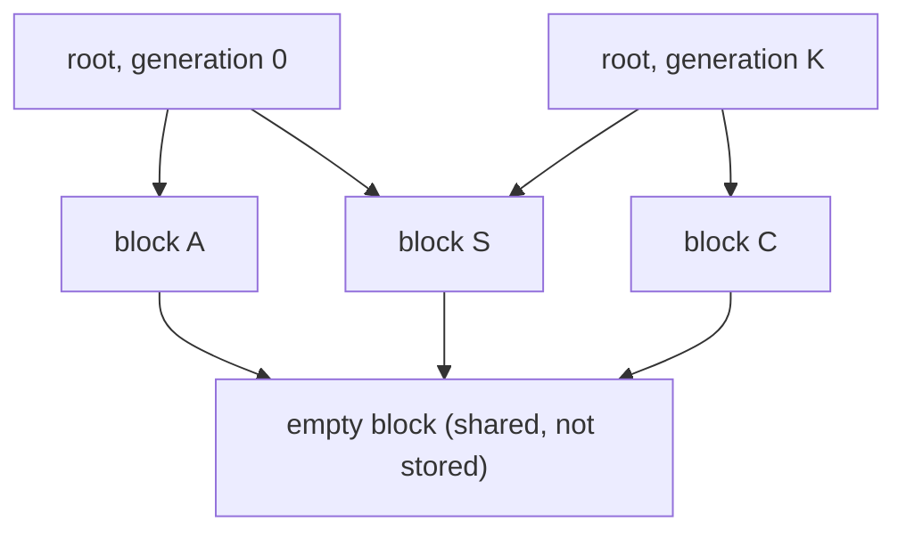

# CelLab Automaton Spec, version 1

This document defines what a valid automaton file is and what it means, how large and infinite worlds are
stored, and what has to change from the current code. It does not prescribe libraries or class layouts.

## Contents

1. [What a spec is](#1-what-a-spec-is)
2. [File conventions](#2-file-conventions)
3. [Shape at a glance](#3-shape-at-a-glance)
4. [Field reference](#4-field-reference)
5. [Conditions](#5-conditions)
6. [Evaluation semantics](#6-evaluation-semantics)
7. [Validation rules](#7-validation-rules)
8. [Examples](#8-examples)
9. [Large and infinite worlds](#9-large-and-infinite-worlds)
10. [Run configuration and persistence](#10-run-configuration-and-persistence)
11. [Changes from the current setup](#11-changes-from-the-current-setup)
12. [Out of scope](#12-out-of-scope)

---

## 1. What a spec is

A spec describes the rules of **one cellular automaton**: edge behaviour, cell states, which cells count as
neighbours, and how each state evolves. It does **not** contain the initial grid: the user paints that in the
UI, so it belongs to a *run*. One spec can be run many times with different grids, sizes and lengths.

**Model.** The world is a 2D matrix of `height` rows by `width` columns (or unbounded, see 9). Every cell holds
one state. Time advances in generations, and every cell is updated simultaneously from the previous generation.

```
spec file --(parse + validate)--> automaton --(+ run config)--> simulation --> stored states
```

---

## 2. File conventions

- UTF-8 YAML that is also valid as JSON: **no anchors/aliases (`&`, `*`), tags (`!!`) or merge keys (`<<`)**.
  The same file is then usable on the backend and in the browser.
- **Unknown keys are errors** at every level.
- **Duplicate keys in one mapping are errors.** Rules are keyed by state name, and many YAML libraries silently
  keep the last duplicate.
- **Names are strings.** Read the file with YAML 1.2 core-schema scalars (where `off`, `on`, `yes`, `no` are
  strings), or quote the name (`"off"`). A name that would read as a boolean, null or number must be quoted; a
  non-string name is a validation error with a hint to add quotes. Generators may quote every name.
- **Counts and sizes are real integers.** Booleans are not integers.
- **Identifiers** (state, group and position names): `^[A-Za-z_][A-Za-z0-9_]{0,63}$`, case-sensitive.
- **Coordinates are `[row, col]`.** Row 0 is the top, column 0 the leftmost.

| Direction | `[row, col]` | Direction | `[row, col]` |
|---|---|---|---|
| `north` | `[-1, 0]` | `north_east` | `[-1, 1]` |
| `east` | `[0, 1]` | `south_east` | `[1, 1]` |
| `south` | `[1, 0]` | `south_west` | `[1, -1]` |
| `west` | `[0, -1]` | `north_west` | `[-1, -1]` |

---

## 3. Shape at a glance

```yaml
spec_version: 1                 # required, integer
name: <string>                  # required
description: <string>           # optional

world:                          # required
  width: <int>                  # bounded worlds: default size, a run may override
  height: <int>
  edges: wrap | fixed           # bounded only, default wrap
  outside: <state name>         # required iff edges is fixed, forbidden otherwise
  infinite: true                # instead of width / edges / outside, see 4.2 and 9

states:                         # required, ordered, list position = integer id, 2..256 entries
  - name: <identifier>          # a bare string is shorthand for {name: <string>}
    color: "#rrggbb"            # optional
    symbol: <one character>     # optional
    description: <string>       # optional

groups:                         # optional
  <group name>: [<state name>, ...]

neighbourhood:                  # required
  shape: moore | von_neumann | diagonal | custom
  radius: <int>                 # presets only, default 1
  offsets:                      # custom only
    <position name>: [<row>, <col>]

update: synchronous             # optional, the only legal value

rules:                          # required
  <state name or group name>:   # the state a cell is currently in
    - becomes: <state name>     # the state it turns into
      when: <condition>         # optional, omitted means always
```

---

## 4. Field reference

### 4.1 Top level

| Key | Required | Notes |
|---|---|---|
| `spec_version` | yes | Integer, must be `1`. A parser must reject versions it does not support. |
| `name` | yes | Non-empty string. |
| `description` | no | Free text. |
| `world`, `states`, `neighbourhood`, `rules` | yes | See below. |
| `groups`, `update` | no | See below. |

Spelling is British (`neighbourhood`, `neighbours`), with no aliases. Additive changes keep `spec_version: 1`;
a change that alters the meaning of existing files bumps the version.

### 4.2 `world`

| Key | Required | Meaning |
|---|---|---|
| `width`, `height` | yes, unless `infinite` | Columns and rows, integers ≥ 1. UI defaults; a run may use another size. |
| `edges` | no | `wrap` (default) or `fixed`. Bounded worlds only. |
| `outside` | iff `fixed` | The state assumed for every out-of-bounds cell. A single state, not a group. |
| `infinite` | no | `true` makes the world unbounded. |

- `wrap`: the grid is a torus.
- `fixed`: the grid ends. Out-of-bounds neighbours count as permanently in the `outside` state.
  (`outside: rock` gives falling sand a floor; `outside: dead` is the usual dead border for Life.)
- A 1-D automaton is `height: 1`.
- `infinite: true`: the world has no edges. `width`, `edges` and `outside` must be absent. `height` must be absent
  (unbounded plane) or `1` (unbounded line, e.g. Rule 30). Every cell that is not explicitly stored is state 0.
  Extra requirements are in 9.1.

### 4.3 `states`

An ordered list of **2 to 256** entries, each a bare string or a mapping:

| Key | Required | Notes |
|---|---|---|
| `name` | yes | Identifier, unique across states. Used everywhere in rules. |
| `color` | no | `#rrggbb`, quoted in YAML. |
| `symbol` | no | One non-whitespace character, unique across states. For text export and test fixtures. |
| `description` | no | UI tooltip. |

- A state's **integer id is its zero-based position** in the list. This is what storage keeps. 256 is the limit
  because ids are stored in one byte per cell.
- **State 0 is the background.** A blank canvas is filled with state 0, and in an infinite world every unstored
  cell is state 0. Start the list with the "empty" state (`dead`, `off`, `empty`).
- State order is part of the automaton's identity (see 10.2).
- Missing `color`/`symbol` are filled in by the implementation and do not affect identity.
- Rules use names, never ids.

### 4.4 `groups`

A mapping from a group name to a non-empty list of state names.

```yaml
groups:
  ant_on_white: [white_ant_n, white_ant_e, white_ant_s, white_ant_w]
```

- The name is an identifier and must not equal a state name. Members must exist, without duplicates.
  Groups cannot contain groups.
- A group is a named set of states, usable wherever a state name is accepted **except** `becomes` and
  `world.outside`. Allowed: as a key of `rules`, as a key inside `neighbours`, as a value in `cells`, and as the
  target of `more_than`.

### 4.5 `neighbourhood`

Which cells around a cell count as its neighbours. **The cell itself is never included.**

| Key | Required | Notes |
|---|---|---|
| `shape` | yes | `moore`, `von_neumann`, `diagonal` or `custom`. |
| `radius` | no | Integer ≥ 1, default 1. Presets only. |
| `offsets` | iff `custom` | Map of position name to `[row, col]`. Custom only. |

| `shape` | Offsets `[dr, dc]` (never `[0, 0]`) | Size at r = 1 |
|---|---|---|
| `moore` | max(\|dr\|, \|dc\|) ≤ r | 8 |
| `von_neumann` | \|dr\| + \|dc\| ≤ r | 4 |
| `diagonal` | \|dr\| = \|dc\| and 1 ≤ \|dr\| ≤ r | 4 |

Custom offsets: non-empty map, identifier names, unique names, `[row, col]` integers, no `[0, 0]`, no two names
sharing an offset.

```yaml
neighbourhood:
  shape: custom
  offsets:
    left:  [0, -1]
    right: [0,  1]
```

**Built-in position names** exist for presets with radius 1: `von_neumann` gives `north`, `east`, `south`,
`west`; `diagonal` gives the four diagonal names; `moore` gives all eight. Presets with radius > 1 have no names;
use `custom` if a rule needs positions. Names exist because *which* neighbour matters for some automata (Rule 30,
traffic, Langton's Ant), while *how many* is enough for others (Life).

### 4.6 `update`

Optional; the only legal value is `synchronous` (the default). The key is reserved for other update modes later.

### 4.7 `rules`

A non-empty mapping. Each key is a state or group name ("rules for a cell currently in this state"). Each value
is a non-empty list of rules:

| Key | Required | Meaning |
|---|---|---|
| `becomes` | yes | The next state. A state name, not a group. |
| `when` | no | A condition (section 5). Omitted means always. `when: {}` is invalid. |

- **Each state is covered by at most one `rules` key**, directly or through a group.
- A state with no entry is **permanent** (walls, recovered individuals).
- `becomes` may name the rule's own state: an explicit "stay" that blocks later rules.
- A rule under a group key applies identically to every member; it cannot depend on which member the cell is.
- **First match wins; no match means unchanged.** A rule list is a decision list, so authors never write
  "otherwise stay".

---

## 5. Conditions

A `when` is a mapping drawn from these keys:

| Key | Value | True when |
|---|---|---|
| `neighbours` | state/group → count test | all listed counts satisfy their tests |
| `cells` | position name → allowed states | all listed positions hold an allowed state |
| `all` | non-empty list of conditions | every one is true |
| `any` | non-empty list of conditions | at least one is true |
| `not` | one condition | it is false |

Several keys at one level are AND-ed. `all` is only needed for nesting, e.g. inside `any`. Empty conditions and
unknown keys are invalid.

### 5.1 `neighbours` (counting)

Each key is a state or group; the value tests "how many neighbours are in that state (or any state of the group)":

| Value | Meaning | Example |
|---|---|---|
| integer `n` | exactly n | `alive: 3` |
| list of integers | any of them | `alive: [2, 3]` |
| mapping with `min` and/or `max` | inclusive range | `alive: {min: 2, max: 3}` |
| mapping with `more_than: <state/group>` | strictly more neighbours in this state than in the named one | `B: {more_than: A}` |

- Integers are ≥ 0; `min` ≤ `max`. A mapping needs at least one of `min`, `max`, `more_than` and may combine them.
- Several keys inside `neighbours` are AND-ed.
- **Counting is per offset, not per distinct cell.** On tiny wrapped worlds two offsets may land on the same
  cell, and it counts twice. Out-of-bounds offsets follow `edges`.
- A tie is not "more than" (the Voter model relies on this).
- `3` ≡ `[3]` ≡ `{min: 3, max: 3}`.

### 5.2 `cells` (positional)

Each key is a position name valid in this neighbourhood. Each value is a state/group, or a non-empty list meaning
"any of these". Unmentioned positions are "don't care". `{west: alive}` ≡ `{west: [alive]}`.

```yaml
cells:
  left: alive              # the left neighbour is alive
  right: [dead, ghost]     # the right neighbour is dead or ghost
```

Conditions are structured data, not expression strings: no grammar to parse, errors point at an exact path, and
nothing can execute.

---

## 6. Evaluation semantics

Any implementation must produce identical generations. Given the previous generation `G`, build `N`. For every
cell `(r, c)` with state `S = G[r][c]`:

1. Find the `rules` key covering `S` (`S` itself, or a group containing it). If none, `N[r][c] = S`.
2. Walk that key's list top to bottom, evaluating each `when` against **`G`** (never the partly built `N`). The
   first rule whose `when` is true or absent sets `N[r][c] = becomes` and stops the walk.
3. If no rule matched, `N[r][c] = S`.

This gives: cell order does not matter; the result is **deterministic** (which is what lets us answer "does it
stabilise?" and "does it cycle?" by comparing grids); and no write conflicts, because each cell sets only itself.
Automata where entities move must be written as "the destination cell pulls the entity in" (Langton's Ant,
traffic).

**Edges.** To read the cell at `(r + dr, c + dc)`:

- `wrap`: use `((r + dr) mod height, (c + dc) mod width)`.
- `fixed`: outside the grid the state is `world.outside`.
- `infinite`: there are no edges; any cell that is not stored is state 0.

---

## 7. Validation rules

Report **all** problems found, each with a location path (e.g. `rules.alive[0].when.neighbours`), because the UI
and the natural-language front-end show them to users.

**Errors** (file rejected):

| ID | Rule |
|---|---|
| V-01 | Valid YAML; no anchors, aliases, tags or merge keys; no duplicate keys; all mapping keys are strings. |
| V-02 | No unknown keys at any level (including reserved keys, section 12); all required keys present. |
| V-03 | `spec_version` is an integer the parser supports. |
| V-04 | `name` is a non-empty string. |
| V-05 | Unless `infinite`: `world.width` and `world.height` are integers ≥ 1. |
| V-06 | `world.edges`, if present, is `wrap` or `fixed`. |
| V-07 | `world.outside` is present exactly when `edges` is `fixed`, and names an existing **state**. |
| V-08 | `states` has 2 to 256 entries; each is a string or a mapping with a valid `name`. |
| V-09 | State names are identifiers, strings and unique. |
| V-10 | `symbol`: one non-whitespace character, unique. `color`: matches `^#[0-9A-Fa-f]{6}$`. |
| V-11 | Group names are identifiers and do not collide with state names; each group is a non-empty list of distinct existing states, no nesting. |
| V-12 | `neighbourhood.shape` is one of the four values. |
| V-13 | `radius`: integer ≥ 1, presets only. `offsets`: required for and only for `custom`. |
| V-14 | Custom `offsets`: non-empty map, identifier names, values `[int, int]`, none `[0, 0]`, no shared offsets. |
| V-15 | `update`, if present, equals `synchronous`. |
| V-16 | `rules` is a non-empty map; every key is an existing state or group. |
| V-17 | No state is covered by more than one rules key (counting group membership). |
| V-18 | Each rules value is a non-empty list of mappings with only `becomes` and optionally `when`. |
| V-19 | `becomes` is present and names an existing **state**. |
| V-20 | Every condition is a non-empty mapping using only section 5 keys; `all`/`any` are non-empty lists; `not` is one condition. |
| V-21 | Every state or group named in `neighbours` (keys and `more_than`) or `cells` exists. |
| V-22 | Count tests are valid: integers ≥ 0, non-empty integer lists, mappings with at least one of `min`/`max`/`more_than` and nothing else, `min` ≤ `max`. |
| V-23 | Every position used in `cells` exists in this neighbourhood. |
| V-24 | `infinite: true` excludes `width`, `edges` and `outside`; `height` is absent or `1`. |
| V-25 | Infinite worlds: state 0 stays state 0 when it and all its neighbours are state 0 (evaluate the rules for that one case). |
| V-26 | Infinite worlds: every neighbourhood offset is within one cell (`radius: 1` presets, or custom offsets with \|row\| ≤ 1 and \|col\| ≤ 1). With `height: 1`, all row offsets are 0. |

---

## 8. Examples

Complete, valid v1 specs. Other automata (cyclic, epidemic with a state chain as timer, basic traffic, straight-down
falling sand, deterministic forest fire, crystal growth) follow the same patterns.

### 8.1 Conway's Game of Life
*Shows:* counting with a list, `not`, and "no match = unchanged". For an unbounded plane replace the `world` block
with `world: {infinite: true}`.

```yaml
spec_version: 1
name: Conway's Game of Life

world:
  width: 50
  height: 50
  edges: wrap

states: [dead, alive]

neighbourhood:
  shape: moore

rules:
  dead:
    - becomes: alive
      when:
        neighbours:
          alive: 3
  alive:
    - becomes: dead
      when:
        not:
          neighbours:
            alive: [2, 3]
```

### 8.2 Brian's Brain
*Shows:* unconditional rules, a three-state cycle, the quoted `"off"`. State 0 is the background.

```yaml
spec_version: 1
name: Brian's Brain

world:
  width: 60
  height: 60

states:
  - name: "off"
    color: "#000000"
  - name: firing
    color: "#ffffff"
  - name: dying
    color: "#3366ff"

neighbourhood:
  shape: moore

rules:
  firing:
    - becomes: dying
  dying:
    - becomes: "off"
  "off":
    - becomes: firing
      when:
        neighbours:
          firing: 2
```

### 8.3 Rule 30
*Shows:* `height: 1`, a custom named neighbourhood, `cells` conditions, `fixed` edges with `outside`, symbols. The
centre cell is implicit because rules are grouped by the cell's own state. For an unbounded tape replace the
`world` block with `world: {infinite: true, height: 1}`.

```yaml
spec_version: 1
name: Rule 30

world:
  width: 101
  height: 1
  edges: fixed
  outside: dead

states:
  - {name: dead,  symbol: "0"}
  - {name: alive, symbol: "1"}

neighbourhood:
  shape: custom
  offsets:
    left:  [0, -1]
    right: [0,  1]

rules:
  dead:
    - becomes: alive
      when:
        cells: {left: alive, right: dead}
    - becomes: alive
      when:
        cells: {left: dead, right: alive}
  alive:
    - becomes: dead
      when:
        cells: {left: alive}
```

Other elementary rules (90, 110, ...) use the same neighbourhood with different rule lists.

### 8.4 Voter Model
*Shows:* `more_than`. A tie matches no rule, so the cell keeps its opinion.

```yaml
spec_version: 1
name: Voter Model

world:
  width: 60
  height: 60

states: [A, B]

neighbourhood:
  shape: moore

rules:
  A:
    - becomes: B
      when:
        neighbours:
          B: {more_than: A}
  B:
    - becomes: A
      when:
        neighbours:
          A: {more_than: B}
```

### 8.5 Langton's Ant
*Shows:* an agent encoded in the cell state, groups as rule keys, `cells` with lists of states, and the
"destination pulls the entity in" pattern. 2 colours × (no ant, or an ant facing N/E/S/W) = 10 states.

- A cell holding an ant always loses it and flips colour (the ant turns, flips the colour and moves on).
- An ant-free cell checks whether an ant is moving into it. If its west neighbour is `white_ant_n` (turns right,
  now faces east) or `black_ant_s` (turns left, now faces east), this cell becomes an ant facing east.

```yaml
spec_version: 1
name: Langton's Ant

world:
  width: 100
  height: 100

states:
  - white
  - black
  - white_ant_n
  - white_ant_e
  - white_ant_s
  - white_ant_w
  - black_ant_n
  - black_ant_e
  - black_ant_s
  - black_ant_w

groups:
  ant_on_white: [white_ant_n, white_ant_e, white_ant_s, white_ant_w]
  ant_on_black: [black_ant_n, black_ant_e, black_ant_s, black_ant_w]

neighbourhood:
  shape: von_neumann

rules:
  ant_on_white:
    - becomes: black
  ant_on_black:
    - becomes: white
  white:
    - becomes: white_ant_e
      when: {cells: {west: [white_ant_n, black_ant_s]}}
    - becomes: white_ant_s
      when: {cells: {north: [white_ant_e, black_ant_w]}}
    - becomes: white_ant_w
      when: {cells: {east: [white_ant_s, black_ant_n]}}
    - becomes: white_ant_n
      when: {cells: {south: [white_ant_w, black_ant_e]}}
  black:
    - becomes: black_ant_e
      when: {cells: {west: [white_ant_n, black_ant_s]}}
    - becomes: black_ant_s
      when: {cells: {north: [white_ant_e, black_ant_w]}}
    - becomes: black_ant_w
      when: {cells: {east: [white_ant_s, black_ant_n]}}
    - becomes: black_ant_n
      when: {cells: {south: [white_ant_w, black_ant_e]}}
```

With several ants, if two enter the same cell the first matching rule wins and the other disappears: deterministic,
but not physically meaningful.

---

## 9. Large and infinite worlds

A world can be unbounded (`infinite: true`) or too big to hold as one array. Two representations are used,
chosen from the spec:

| Representation | Used when |
|---|---|
| **Array**: the whole grid as one array of state ids | the world is bounded |
| **Tree**: only the non-empty parts, with identical parts shared | `infinite: true` |

A bounded world that exceeds the run's `max_array_bytes` is refused with a clear message. (Measured on the
current engine: 25 to 36 bytes per cell while stepping, so about 3 GB at 10⁸ cells.)

### 9.1 What an infinite world needs

- Deterministic rules (always true in v1).
- State 0 is the background and is stable (V-25).
- Neighbourhood reach 1 (V-26).
- A finite initial pattern: the run lists the non-0 cells as `[row, col]` relative to `[0, 0]`; negative
  coordinates are allowed.

### 9.2 How the tree works

The world is split into square blocks (segments in 1-D). A block is made of four smaller blocks (two in 1-D), down
to small blocks of cells. Three rules keep it small:

- **Empty space is never stored.** All state-0 blocks of one size are the same shared "empty" block.
- **Identical blocks are stored once**, within one generation and across generations.
- **The world is one root block just big enough for the pattern**, with everything outside it implied state 0.
  When the pattern grows, the root is wrapped in a bigger block of background.

So yes: we store only what is needed, plus background around it.



Stepping also uses the tree: each block remembers what its centre looks like after `2^(k-2)` generations, where
`2^k` is the block's side. Results are cached, so advancing far costs time proportional to the number of
*distinct* blocks, not to generations × cells. Generation K is reached by a few such jumps. Each block also keeps
its per-state cell counts.

### 9.3 Saving states

Bounded worlds keep checkpoints of the full array. Infinite worlds keep only the new blocks plus one root pointer
per saved generation; consecutive generations share almost all blocks, so a saved generation costs only what
changed.

The run's retention setting decides which generations are kept:

| Setting | Keeps |
|---|---|
| `all` | every generation |
| `every_k` | every K-th generation |
| `last` | the final generation only |
| `none` | nothing |
| `budgeted` | at most B checkpoints: keep every C-th; when there are more than B, drop every other one and double C. Storage stays bounded without knowing the run length. |

Getting generation K: load the nearest kept generation at or before K, then step forward (array) or jump
forward (tree). **Cycle shortcut:** once a cycle is found (start `mu`, period `p`, and for a moving pattern a
shift), every later generation follows from it: `state(K) = state(mu + (K - mu) mod p)`, shifted by
`floor((K - mu) / p)` times the shift.

### 9.4 Answering the five questions

| Question | Bounded (array) | Infinite (tree) |
|---|---|---|
| State after N | nearest checkpoint, then replay | jump from the nearest saved root; show a viewport |
| Count of state X | count in the grid | read from the root's stored counts (state 0 is infinite: report the other states) |
| Stable state | a generation equals the previous one | the root block is unchanged after one step |
| Cycle | a generation repeats an earlier one (compare hashes; for very long runs use Brent's method, which keeps only two states) | the pattern repeats, possibly shifted (a glider); compare after recentring |
| Configuration occurs | search each generation | same, over the non-empty part |

On a bounded world the answer is always definite: rules are deterministic and the number of states is finite, so
the run must eventually repeat. On an infinite world a pattern can grow forever, so the answer is either **found
at generation g** or **not found within the limit**; "never" cannot be proved.

### 9.5 Limits

- Only finite patterns on an empty background can be stored. Infinite structures with no repetition (an infinite
  random field) cannot.
- Chaotic automata (Rule 30, random soups) share few blocks, so the tree gives little. Rule 30 on an unbounded
  tape costs about N² cell updates: fine up to about 10⁵ to 10⁶ generations, not 10⁹.
- Infinite worlds need neighbourhood reach 1.
- Bounded worlds always use the array. Using the tree for a huge bounded world is a later extension.
- Generation numbers above 2⁶³ can be answered (cycle shortcut or jump) but not stored.

---

## 10. Run configuration and persistence

### 10.1 Not in the spec (set per run, in the UI)

- the initial grid (painted, or generated); for infinite worlds a finite list of non-0 cells
- the actual grid size (spec `width`/`height` are defaults)
- number of generations
- retention setting (9.3) and checkpoint interval K
- `max_array_bytes`
- (future) the random seed, once probabilistic rules exist

### 10.2 What persistence needs from the spec

| Item | Source |
|---|---|
| Grid width and height | run config, defaulting to `world`; absent for infinite worlds |
| Number of states | `len(states)`; ids are list positions |
| Spec hash | a fingerprint of the rules, stored with every saved state |

Changing a colour must not invalidate stored states; reordering states must.

| Semantic (in the hash) | Presentational (not) |
|---|---|
| `spec_version`, `world.edges`, `world.outside`, `world.infinite` | `name`, `description` |
| `states` names and **order** | `states[].color`, `symbol`, `description` |
| `groups`, `neighbourhood`, `update`, `rules` | `world.width`, `world.height` |

Equivalent spellings (5.1 forms, state shorthand) hash the same. Mapping key order does not matter; list order does.
The exact canonicalisation belongs to the persistence layer.

---

## 11. Changes from the current setup

Direction: keep the `domain` classes, add the pieces below. `domain/` must not import from `services`,
`infrastructure` or `web`.

| Area | Change |
|---|---|
| **Spec format** | The current parser (`cellab/parser`) reads an earlier format: `schema_version`, `cell_types`, `world.size` + `boundary`, `neighborhood` with `type`/`points`, rules as a `rules:` list of `when`/`then`/`otherwise` or a `rule:` totalistic/lookup block, probabilities, and `initial_state` inside the spec. This document uses `spec_version`, `states`, `width`/`height`, `edges`/`outside`, `neighbourhood` with `shape`/`offsets`, rules grouped by state with `becomes`, groups and `cells` conditions, no probabilities, and the initial grid in the run. Decide which format wins, then bring the models and compiler in line. |
| **Domain, needed by this spec** | Conditions on a named neighbour position; conditions on a set of states (groups) for the cell and for counts; `more_than`; the `diagonal` shape; names for neighbourhood offsets. |
| **Domain, for infinite worlds** | `Automaton.is_quiescent()` (V-25); a `Universe` interface with an array implementation (wrapping `Grid`) and a tree implementation. |
| **Bug to fix** | A rule that is deterministic by construction (`WithProbability` 0 or 1, `RandomChoice` with one outcome) reports `is_deterministic` but still raises without an rng. The tree relies on this flag. |
| **Performance** | `Grid.__init__` re-scans and copies on every step; add a fast path for `uint8` arrays. `build_initial_state` builds an `int64` array first (8 bytes per cell); build `uint8`, and for infinite worlds return only the non-0 cells. |
| **Services** (empty today) | Simulator, retention policies (9.3), one class per question (9.4). |
| **Infrastructure** (empty today) | Checkpoint storage on the existing tables; tree block and root storage. |
| **Database** | Make `width`, `height`, `checkpoint_every` nullable; add `seed`, `representation`, `retention`, and a cycle result; add tables for tree blocks and tree roots (origins and counts as `NUMERIC`, they can exceed 64 bits). The init script only runs on an empty volume: apply by hand or `docker compose down -v`. |
| **README** | SQLite → PostgreSQL; replace the `.cstate` section with a link to section 9; `WolframRule` → `LookupTableRule`; remove or use the empty `spec/` folder. |

**Build order:** (1) array representation, retention, simulator and the five questions on bounded worlds;
(2) spec format alignment; (3) `infinite` in the spec plus validation; (4) the tree, first in 1-D, checked against
plain stepping for all 256 elementary rules; (5) 2-D, tree storage, variable-length jumps and the cycle shortcut.

---

## 12. Out of scope

**Reserved keys.** Not valid in v1, rejected like any unknown key (ideally with "not supported in spec_version 1"):

| Location | Key | For |
|---|---|---|
| top level | `attributes` | numeric values per cell (sandpile, diffusion) |
| top level | `view` | display hints (space-time diagram for 1-D) |
| rule | `chance` | probabilistic rules |
| rule | `set` | arithmetic on attributes |

**What v1 cannot express:**

| Feature | Affected automata |
|---|---|
| Probabilities (needs a seed in the run) | stochastic Forest Fire, Epidemic, Traffic braking |
| Numeric values per cell | Sandpile, Diffusion, Traffic velocity, Predator-Prey energy |
| Entities moving to contested targets | Predator-Prey, Schelling, Ecosystem, full Falling Sand |
| Percentage tests | Schelling |
| Centre cell in counts | some averaging rules |
| Asynchronous updates | Langton's Ant as a true agent (covered by the state encoding) |

Of the 15 listed automata: **fully expressible** are Elementary rules, Brian's Brain, Cyclic, Langton's Ant
(single ant), Forest Fire (deterministic), Traffic (basic), Epidemic (deterministic), Voter, Crystal Growth;
**partly** Falling Sand (straight down); **need extensions** Sandpile, Diffusion, the stochastic variants,
Predator-Prey, Schelling, Ecosystem.

---

